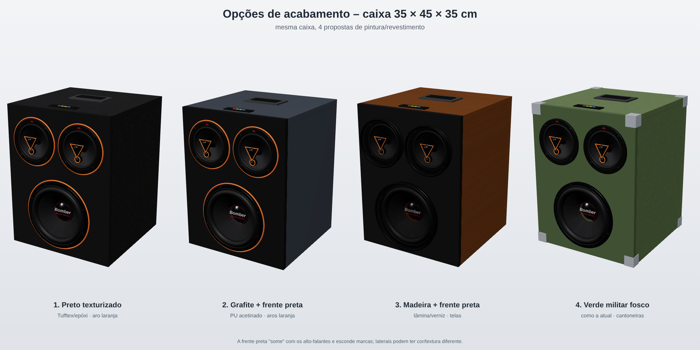
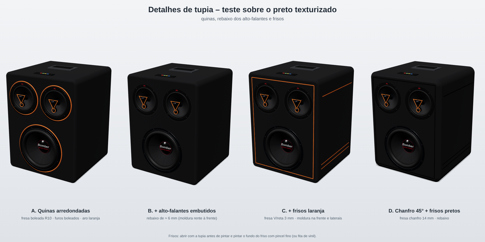
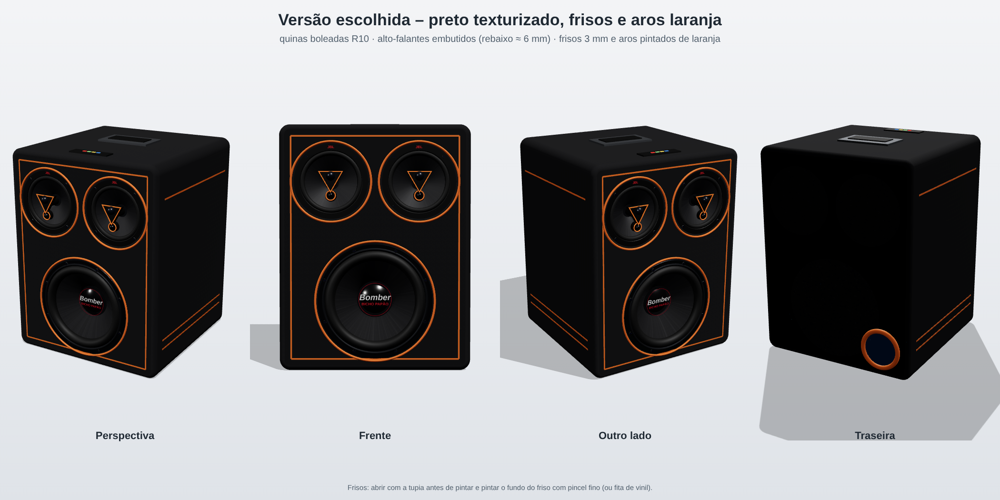

# Acabamento da caixa (35 × 45 × 35 cm)

| # | Acabamento | Material | Prós | Contras |
|---|---|---|---|---|
| 1 | Preto texturizado + aro laranja | Tinta texturizada (tipo Tufftex/"Duratex") ou epóxi texturizado | Esconde imperfeição do MDF, resiste a risco, visual "pro audio" | Precisa de compressor/rolo próprio |
| 2 | Grafite + frente preta + aros laranja | PU automotivo acetinado (laterais) + preto fosco (frente) | Visual premium, fácil de limpar | PU risca mais; exige mais preparo (massa, lixa) |
| 3 | Madeira + frente preta + telas | Lâmina de madeira/verniz PU ou adesivo vinílico madeirado | Bonito em casa, "móvel" | Mais caro; quina sofre batida |
| 4 | Verde militar fosco + cantoneiras | Tinta fosca (como a atual) + cantoneiras metálicas | Robusto para transporte, identidade da caixa atual | Visual mais rústico |

## Passo a passo de pintura em MDF
1. Arredondar as quinas (lixa ou tupia, raio de 3 a 6 mm). Tinta não segura bem em quina viva.
2. **Selar as bordas do MDF**, que absorvem muito: cola PVA diluída ou fundo selador, 2 a 3 demãos, lixando com grão 220 entre elas.
3. Fundo primer (PU ou nitro) na caixa toda. Lixa d'água 320–400.
4. Massa rápida só nas falhas. Lixar de novo e passar mais uma demão de primer.
5. Tinta final:
   - Texturizada: rolo de espuma de textura ou pistola de textura, 2 demãos.
   - PU: 2–3 demãos finas e verniz acetinado ou fosco por cima.
6. Pintar os aros laranja antes de montar os alto-falantes, com a frente mascarada (fita crepe e um molde redondo).
7. Esperar a cura total (de 24 h a 7 dias, conforme a tinta) antes de montar e transportar.

## Detalhes que deixam com cara de produto
- Telas metálicas (grade perfurada) para os 3 alto-falantes.
- Cantoneiras e pés de borracha.
- Alça embutida de metal (já prevista no topo).
- Painel traseiro com tomada IEC, chave, voltímetro e grelha de ventilação.
- Logo da marca: adesivo recortado ou gravação a laser numa placa de acrílico.

## Teste de detalhes com tupia

## ✅ Versão escolhida: C + aros laranja

- **Pintura:** preto texturizado (tipo Tufftex ou epóxi texturizado) na caixa toda.
- **Quinas:** boleadas com fresa de raio 10 mm. Os furos dos alto-falantes também levam a borda boleada.
- **Alto-falantes embutidos:** rebaixo de ≈ 6 mm, do tamanho da moldura, feito com a tupia e um compasso ou gabarito circular. Rebaixo para o sub com ≈ Ø 211 mm; para os JBL, medir a moldura (≈ Ø 141 mm).
- **Frisos de 3 mm** (fresa reta ou em V, ≈ 2 mm de profundidade), pintados de laranja:
  - na frente, uma moldura a 22 mm da borda;
  - em cada lateral, 1 friso em cima e 2 embaixo.
- **Aros laranja** em volta dos 3 alto-falantes (anel pintado de ≈ 4 mm na borda do rebaixo), e um aro laranja na saída do duto atrás.
- **Ordem:** cortar e colar → tupia (quinas, rebaixos, frisos) → selar bordas → primer → texturizado preto → pintar frisos e aros de laranja com pincel fino, fita crepe ou vinil laranja → montar.
