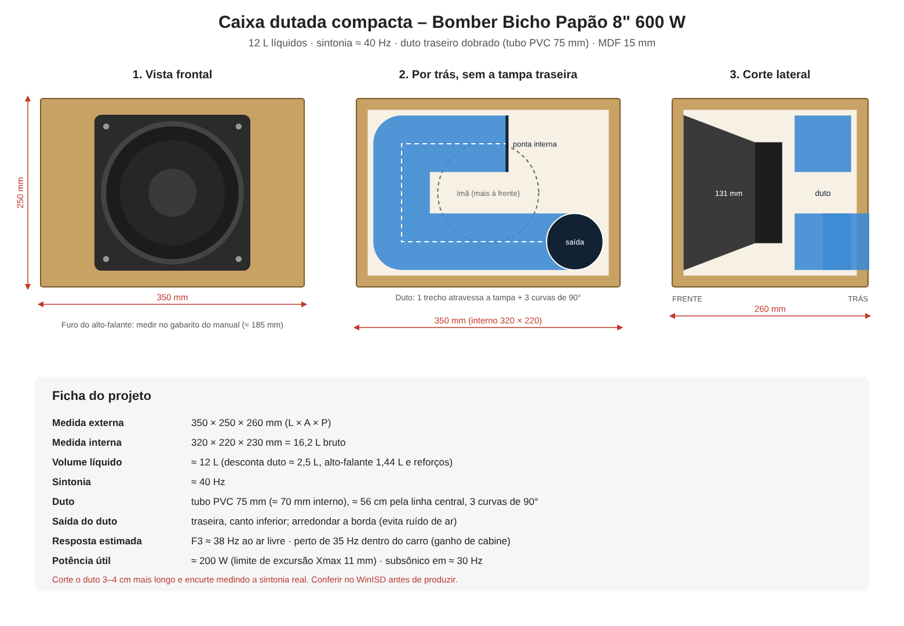
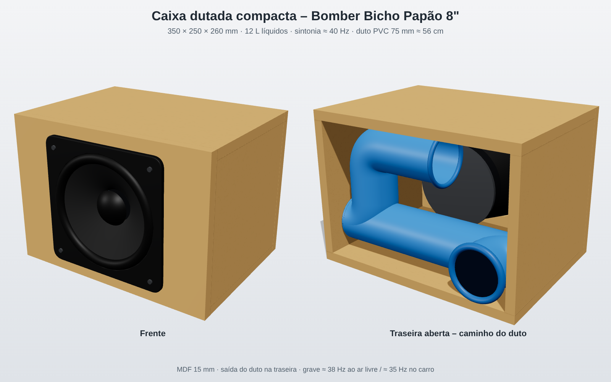

# Projeto: caixa compacta com Bomber Bicho Papão 8" 600 W (cód. 1.23.121)

Objetivo: caixa compacta, de boa qualidade, com grave o mais perto possível de **35 Hz** (F3). O projeto é para replicar e vender.

## Parâmetros (manual Bomber, rev. 02, 04/02/2026)
| Fs | Qts | Qes | Vas | Sd | Mms | Xmax | Xlim | Volume ocupado |
|---|---|---|---|---|---|---|---|---|
| 46 Hz | 0,47 | 0,49 | 8,33 L | 183 cm² | 66,28 g | 11 mm | 19 mm | 1,44 L |

- O EBP é Fs ÷ Qes ≈ 94. Está na fronteira, e a caixa dutada funciona bem.
- Re não foi encontrado e foi estimado em 3,4 Ω. Com isso, Bl ≈ 11,5 e Qms ≈ 11,5 (o Vas recalculado bate: 8,6 L).

## Simulação (`ferramentas/sim_caixa.py`, ao ar livre, sem ganho de cabine)

**Selada:** não chega a 35 Hz. O F3 fica em cerca de 70 Hz com qualquer volume, e em 35 Hz o som já está cerca de 10 dB abaixo.

**Dutada (volume líquido):**
| Volume | Fb | F3 | F6 | Pico |
|---|---|---|---|---|
| 10 L | 38 Hz | 42 Hz | 34 Hz | plano |
| 12 L | 38 Hz | 38 Hz | 33 Hz | plano |
| **15 L** | **36–38 Hz** | **≈ 35 Hz** | 31 Hz | plano |
| 18 L | 35 Hz | 32 Hz | 29 Hz | plano |
| 20 L | 35 Hz | 32 Hz | 29 Hz | plano |
| 25 L+ | — | — | — | começa a formar pico (+1,6 a +5 dB) |

## Proposta inicial para testar
- **15 L líquidos, Fb ≈ 37 Hz.**
- **Duto redondo de 7,5 cm, com cerca de 55 cm de comprimento** (com uma ponta rente à parede). Ocupa cerca de 2,4 L.
- **Volume bruto interno ≈ 19 L** (15 + duto + alto-falante + reforços). Exemplo: 27 × 27 × 27 cm por dentro, ou cerca de 30 × 30 × 30 cm por fora em MDF de 15 mm.
- Dá para usar o duto dobrado ou em fenda com área de cerca de 45 a 55 cm². O comprimento muda, então recalcular.

## Limites encontrados
- **Excursão:** perto de 45 a 60 Hz, o cone chega ao Xmax (11 mm) com cerca de **150 a 200 W em tom contínuo**. Com 600 W contínuos ele passaria do Xlim. Com música dá para usar mais, mas o produto precisa de **filtro subsônico em cerca de 28 Hz** e de limitador.
- **Velocidade no duto de 7,5 cm:** 16 m/s a 100 W e 23 m/s a 200 W. Fica na zona intermediária quando o cone está no limite, então arredondar as pontas do duto.
- **Duto de 10 cm:** daria cerca de 100 cm de comprimento e ocuparia 8 L, o que é inviável numa caixa compacta.

## Alternativas para compactar
- **Radiador passivo** no lugar do duto. É o que caixas portáteis comerciais usam, porque não tem duto longo nem ruído de ar.
- **DSP / equalização** (Linkwitz transform) numa caixa selada pequena. Exige mais potência e excursão.
- **No carro**, o ganho de cabine reforça o grave abaixo de cerca de 50 a 60 Hz. Uma caixa de 10 a 12 L pode soar como 35 Hz lá dentro.

## Próximos passos
1. Confirmar Re e a tabela de caixa do manual oficial da Bomber (PDF 3.27.443-1.23.121).
2. Conferir no WinISD.
3. Construir o protótipo e medir a sintonia real (impedância ou microfone).

## Opções COMPACTAS (prioridade: caixa pequena)

Simulação feita com `ferramentas/sim_compacta.py`, ao ar livre a 1 m. Potência limitada pelo Xmax de 11 mm.

| Opção | Volume líquido / bruto | F3 | SPL máx. em 35 Hz | SPL máx. em 60 Hz | Observação |
|---|---|---|---|---|---|
| Selada + DSP (Linkwitz, alvo F3 35 Hz) | 6 L / ~8 L | **35 Hz** | 98 dB | 101 dB | A menor; só usa ~45 W (limitada pela excursão); exige amplificador com DSP |
| Dutada, Fb 40 Hz, duto 6 cm × 49 cm | 10 L / ~13 L | 42 Hz | 103 dB | 108 dB | Duto de 6 cm passa de 30 m/s no limite: precisa de pontas arredondadas |
| Dutada, Fb 40 Hz, duto 7 cm × 67 cm | 10 L / ~14 L | 42 Hz | 103 dB | 108 dB | Mais silenciosa (15 m/s a 100 W); duto dobrado |
| Dutada, Fb 38 Hz | 12 L / ~15 L | 38 Hz | 104 dB | 107 dB | |
| Radiador passivo 8", Fb 36 Hz | 10 L | ~51 Hz | 101 dB | 106 dB | Dispensa duto, mas perde extensão; não compensa com este alto-falante |

**Conclusões:**
- **Abaixo de 10 L sem DSP**, não dá para ter F3 de 35 Hz ao ar livre com este alto-falante.
- **No carro**, o ganho de cabine compensa: a dutada de 10 L (F3 42 Hz ao ar livre) deve chegar perto de 35 Hz dentro do veículo.
- **Para produto doméstico ou portátil pequeno**, o caminho é a selada com DSP. É menor e mais grave, mas toca mais baixo (cerca de 5 dB a menos).

## Desenho do protótipo (dutada compacta)

- **Medida externa:** 350 × 250 × 260 mm.
- **Medida interna:** 320 × 220 × 230 mm (16,2 L bruto, cerca de 12 L líquidos).
- **Sintonia:** cerca de 40 Hz. F3 de cerca de 38 Hz ao ar livre, perto de 35 Hz no carro.
- **Duto:** tubo PVC de 75 mm, com cerca de 56 cm pela linha central e 3 curvas de 90°. Fica no plano a 45 mm da tampa traseira (cerca de 16 mm de folga para o ímã) e sai pela traseira.
- A profundidade foi aumentada de 240 para 260 mm para o duto não encostar no ímã.
- Desenho gerado por `ferramentas/desenho_caixa.py`.

## Imagem 3D

Gerada por `ferramentas/render3d/`.

## Versão vertical (alternativa, não escolhida)
- **Medida externa:** 250 × 350 × 260 mm (L × A × P), em MDF de 15 mm.
- **Medida interna:** 220 × 320 × 230 mm, ou seja, 16,2 L bruto e cerca de 12 L líquidos. É o mesmo volume da versão deitada, então a sintonia e o grave não mudam.
- **Alto-falante:** um pouco acima do centro (centro a 45 mm acima do meio).
- **Duto:** tubo PVC de 75 mm em "U" invertido, no plano a 45 mm da tampa traseira, com cerca de 56 cm pela linha central.
  - Sai pela traseira, no canto de baixo.
  - Sobe pela lateral, atravessa por cima e desce do outro lado até cerca de 13,5 cm do fundo.
- Gerada antes; para refazer, trocar W/H em `ferramentas/render3d/index.html`.

## ✅ Versão escolhida: deitada (comprimento maior)
- **Medida externa:** 350 × 250 × 260 mm (L × A × P).
- **Medida interna:** 320 × 220 × 230 mm, cerca de 12 L líquidos.
- **Duto:** "U" deitado atrás do ímã, com cerca de 56 cm.
- O desenho técnico (`projeto-bp8-caixa.png`) e a imagem 3D (`projeto-bp8-caixa-3d.png`) mostram esta versão.
