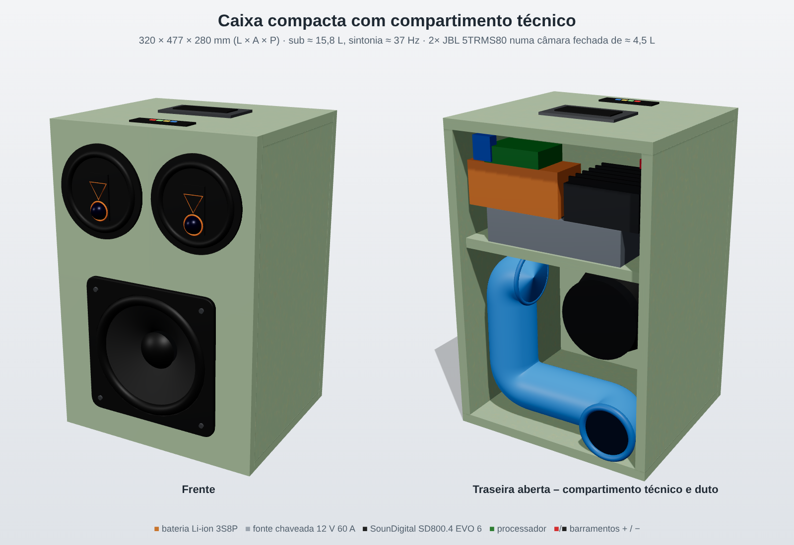
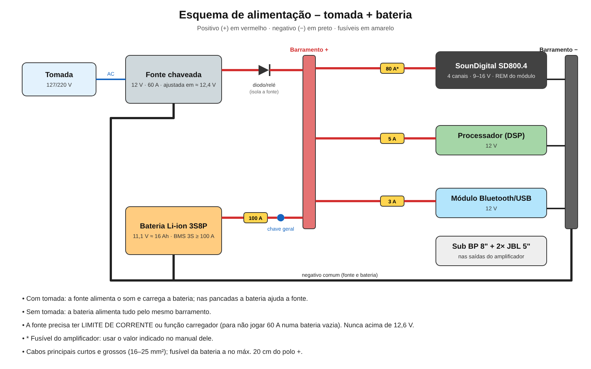
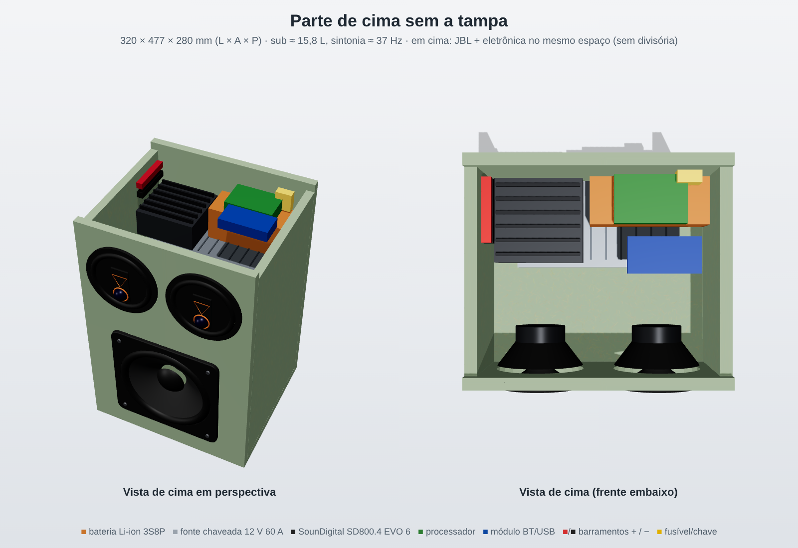
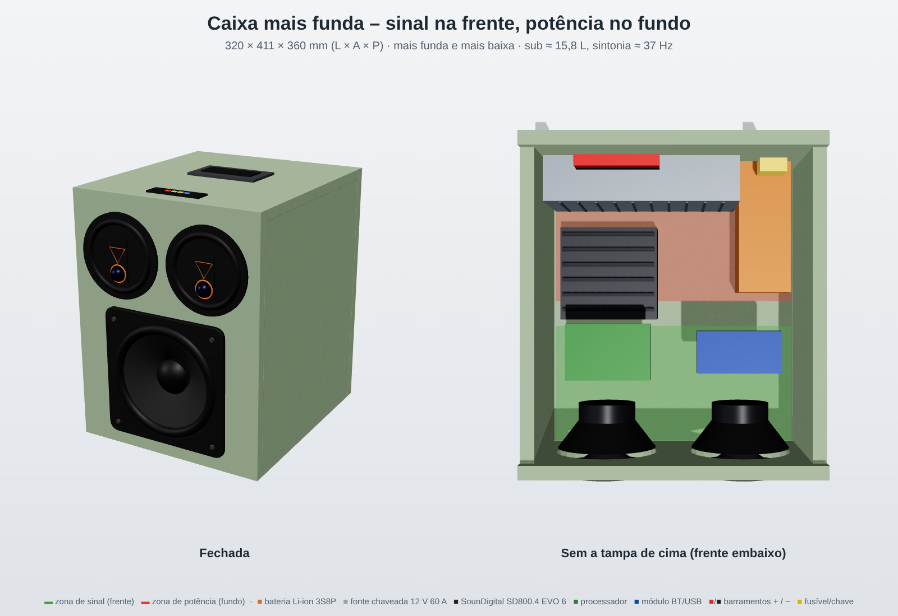

# Projeto: caixa compacta (substituir o som atual)

## Som atual (referência do vídeo)
- Caixa em pé de MDF verde, com alça e módulo Bluetooth/USB no topo.
- 2 × JBL Multisystem coaxial de 5" lado a lado em cima.
- Bomber Outdoor de 10" embaixo, com duto em fenda na base da frente.
- O dono gosta do som, mas acha a caixa grande. O Outdoor de 10" não será reaproveitado.
- Amplificador de 800 W.

## Proposta

- **Medida externa:** 320 × 450 × 300 mm (L × A × P), cerca de 43 L. Em MDF de 15 mm.
- **Câmara de cima:** dividida em 2 câmaras **fechadas** de cerca de 5,5 L, uma para cada JBL de 5" (interno 137 × 150 × 270 mm cada).
- **Câmara de baixo:** Bomber Bicho Papão 8", interno 290 × 252 × 270 mm, ou seja, 19,7 L bruto e cerca de 15,8 L líquidos.
  - Sintonia em cerca de 37 Hz e F3 de cerca de 34 Hz ao ar livre (veja `projeto-bomber-bp8.md`).
  - Duto de PVC 75 mm, com cerca de 48 cm em "L/U", saindo pela traseira embaixo.
- **Alto-falantes na frente:**
  - JBL com centro a 75 mm do eixo central da caixa, na altura do meio da câmara de cima.
  - Sub com centro a 141 mm acima do fundo externo.
- **Topo:** alça e módulo, como na caixa atual.

## Ajustes de amplificador / DSP
- **Sub:**
  - Filtro passa-baixas em cerca de 80–100 Hz.
  - **Subsônico em cerca de 28 Hz.**
  - Ganho limitado: acima de cerca de 170–200 W em grave contínuo o cone passa do Xmax, e o sub aguenta no máximo 600 W RMS.
- **JBL:** filtro passa-altas em cerca de 100–120 Hz, porque numa câmara pequena eles não devem receber grave.

## A confirmar
- Furo e profundidade dos JBL Multisystem 5" (medir; um 5" típico tem furo de cerca de 11–12 cm e frame de cerca de 13,5 cm).
- Medidas da caixa atual, para comparar.
- Quantos canais tem o amplificador de 800 W.

## Revisão: compartimento técnico (tomada + bateria)

- **Medida externa:** 320 × 480 × 340 mm (L × A × P).
- **Câmara do sub (embaixo):** interno 290 × 220 × 310 mm, cerca de 15,8 L líquidos. Duto de 75 mm com cerca de 48 cm saindo pela traseira.
- **JBL:** os dois juntos numa câmara **fechada** na frente de cima (interno 290 × 215 × 110 mm, cerca de 6 L).
- **Compartimento técnico:** atrás da câmara dos JBL (interno 290 × 215 × 185 mm, cerca de 11,5 L), vedado em relação às câmaras de som.
  - Tampa traseira removível, com grelha de ventilação e, se precisar, uma ventoinha de 12 V.
  - Cabem a bateria LiFePO4 12 V 20 Ah (em pé), a fonte chaveada 60 A (deitada), o amplificador (preso na parede) e o processador.
  - Os barramentos + e − e o fusível com chave geral ficam na lateral.
- **Alimentação:**
  - A fonte chaveada 12 V 60 A fica ajustada em 14,2–14,4 V e precisa ter **limite de corrente** ou função carregador.
  - Ela fica em paralelo com a bateria pelo barramento. Com tomada, a fonte alimenta o som e carrega a bateria. Sem tomada, a bateria segura tudo.
  - Um diodo ou relé isola a fonte quando está desligada.
- **Fusíveis:**
  - bateria: 100 A, perto do polo;
  - amplificador: conforme o manual;
  - processador: 5 A;
  - módulo: 3 A.
- **Cabos principais:** 16–25 mm².

## Bateria montada com solda ponto (análise)
- **ICR18650 2200 mAh (anúncio barato): NÃO usar.**
  - É química de baixa descarga, cerca de 1–2C (≈ 2–4 A por célula).
  - Para picos de 40–80 A do amplificador de 800 W seriam precisas de 10 a 20 células em paralelo.
  - As células são de procedência duvidosa (código borrado).
- **Li-ion em 3S** (11,1 V nominal, 12,6 V cheio) **não combina com a fonte em 14,2–14,4 V**: sobrecarrega e há risco de incêndio. Só serviria com a fonte travada em 12,6 V.
- **Recomendado: LiFePO4 32700 (3,2 V, ~6 Ah) em 4S3P.**
  - 12,8 V nominal e 14,6 V cheio, o que é compatível com som automotivo e com a fonte em 14,2–14,4 V.
  - 12 células, ≈ 18 Ah e ≈ 230 Wh.
  - Tamanho de ≈ 13 × 10 × 7,5 cm e peso de ≈ 1,8 kg.
  - A descarga típica é de 3C (≈ 18 A por célula, ≈ 54 A no pack); conferir no datasheet.
  - BMS **4S LiFePO4** com balanceamento, de ≥ 100 A.
  - Fita de níquel puro grossa (0,2 mm, em várias camadas) ou chapa de cobre/níquel; existem 32700 com terminal de parafuso, que não precisam de solda.
- **Alternativa Li-ion:** 18650 de alta descarga (Samsung 25R, LG HG2, Molicel P28A) em 3S, com fonte limitada a 12,6 V.

## Pack Li-ion 3S7P / 3S8P (fonte regulada em ~12,4 V)
- 3S7P = 21 células; 3S8P = 24 células (por exemplo, 3 kits de 10 de 2000 mAh, com sobra para descartar ruins).
- Corrente por célula num pico de 40–60 A: ≈ 5–8 A (7P) ou 5–7,5 A (8P). Na média de ≈ 10 A: ≈ 1,3 A por célula.
- Capacidade nominal: 14 Ah (7P) ou 16 Ah (8P), ≈ 155–180 Wh. Em células genéricas a real costuma ser menor.
- Tamanho do 3S8P deitado: ≈ 15 × 6 × 7 cm, ≈ 1,1 kg.
- Obrigatório: testar capacidade e resistência interna de cada célula, montar grupos paralelos equilibrados, BMS 3S ≥ 100 A com balanceamento, e ligações série dimensionadas para 60–80 A.

## Revisão com componentes reais
- **JBL Multisystem 5TRMS80** (triaxial): 80 W RMS, 4 Ω, Fs 91 Hz, 87 dB, resposta de 76 Hz a 20 kHz.
  - O anúncio diz "largura 6,8"" — **medir**: se forem 17 cm, os dois não cabem lado a lado em 32 cm. O projeto supõe cerca de 13,5 cm.
- **SounDigital SD800.4 EVO 6:** 4 canais, 800 W RMS a 4 Ω (≈ 200 W por canal), alimentação de 9–16 V, 11,2 × 10,7 × 5,2 cm, com filtros passa-altas e passa-baixas.
  - Canal 1: sub BP 8" (4 Ω). ~200 W combina com o limite de excursão, e não precisa ligar em ponte.
  - Canais 2 e 3: os JBL, com passa-altas em 100–120 Hz e ganho moderado (80 W RMS cada).
  - Canal 4: livre.
  - Com o pack 3S (9–12,6 V) a potência fica abaixo da nominal, mas suficiente.
  - **BMS cortando em 3,1–3,2 V por célula** (9,3–9,6 V), para o amplificador não desligar no pico, já que o mínimo dele é 9 V.
  - **O subsônico (~28 Hz) deve ficar no processador.** O anúncio do amplificador não cita subsônico.
- **Caixa revista:** 320 × 477 × 280 mm (L × A × P), ≈ 43 L.
  - Câmara do sub: interno 290 × 272 × 250 mm, ≈ 15,8 L líquidos, com duto de ≈ 48 cm.
  - Câmara dos JBL: na frente de cima, 290 × 160 × 110 mm (≈ 4,5 L líquidos).
  - Compartimento técnico: atrás dela, 290 × 160 × 125 mm, com a fonte deitada embaixo e, por cima, o amplificador e a bateria 3S8P; o processador fica sobre a bateria.

## Decisão: médios e eletrônica juntos em cima (sem divisória)
- A parte de cima (interno 290 × 160 × 250 mm, ≈ 11,6 L) é um espaço único: os JBL na frente e a eletrônica atrás. Os equipamentos ocupam ≈ 3,5 L e sobram ≈ 8 L de ar para os médios, o que é suficiente.
- **A divisória horizontal entre a parte de cima e o sub continua obrigatória e vedada**, com cola e silicone e passagem de cabos com prensa-cabo ou silicone, para não estragar a sintonia.
- **Calor:** a fonte e o amplificador precisam de ventilação.
  - Grelha na tampa traseira e uma ventoinha de 12 V puxando ar para fora.
  - Com o passa-altas de 100–120 Hz, a parte de cima ventilada não prejudica os JBL, que são triaxiais automotivos feitos para porta de carro.
- **Bateria:** longe da saída de ar quente da fonte e do amplificador (Li-ion não gosta de calor acima de ~45 °C).
- Tudo preso com parafuso e coxim de borracha (vibração do sub). Não cobrir a ventilação com espuma acústica; a espuma vai só atrás dos JBL.

## Vista sem a tampa de cima

- Os JBL ficam na frente. Atrás deles, a fonte fica deitada no fundo e, por cima dela, o amplificador (à esquerda) e a bateria 3S8P (à direita).
- O processador fica sobre a bateria. A placa do módulo BT/USB fica presa por baixo da tampa.
- Os barramentos ficam na lateral esquerda e o fusível com a chave fica atrás, à direita.

## Versão mais funda (contra interferência) — atual

- **Medida externa:** 320 × 411 × 360 mm (L × A × P), ≈ 47 L. A caixa fica mais baixa e mais funda.
- **Câmara do sub:** interno 290 × 206 × 330 mm (≈ 19,7 L bruto, ≈ 15,8 L líquidos). A sintonia (~37 Hz) e o duto de ≈ 48 cm continuam iguais, com o "U" mais achatado.
- **Parte de cima:** interno 290 × 160 × 330 mm, dividida em zonas (sem divisória física):
  - **Zona de sinal (frente, ~14 cm):** JBL, processador e módulo BT/USB, por baixo da tampa.
  - **Zona de potência (fundo, ~16 cm):** fonte em pé encostada na traseira, bateria na lateral, barramentos e fusível.
  - **Meio:** o amplificador, entre as duas zonas.
  - O módulo e o processador ficam a ≈ 20 cm da fonte.
- **Contra ruído e chiado:**
  - Ponto de terra único no barramento − (aterramento em estrela).
  - Cabos de áudio (RCA) longe dos cabos de força; quando precisarem se cruzar, cruzar em 90°.
  - Cabos de força trançados (+ e − juntos).
  - Ferrite e filtro LC na alimentação do módulo e do processador. Se ainda chiar, usar isolador de terra (ground loop isolator) no áudio do módulo.
  - Antena do Bluetooth longe de metal e da fonte.
